# Awesome Cross-Platform Mobile Frameworks 📱✨

  

  
  
  
  
  
  

---

## 🚀 Overview & Ecosystem

A curated index of top **SaaS platforms**, **developer cloud services**, and **open-source GitHub projects** for **Cross-Platform Mobile Application Development**. Build native-quality apps across iOS, Android, Web, and Desktop from a single shared codebase—spanning JavaScript/TypeScript runtimes, compiled languages like Dart, Kotlin, Rust, and C#, and cloud-native mobile CI/CD pipelines.

---

## 📊 Sector Overview & Market Dynamics

The global cross-platform mobile app development platform and tools market is estimated at **$105B – $125B in 2025/2026**, on track to surpass **$300B+ by the early 2030s** at an estimated CAGR of ~16%. 

The market exhibits a **bimodal dynamic**:
- **Core Framework Layer (Highly Concentrated / Winner-Take-Most):** Dominated by a tight oligopoly backed by big tech—primarily **Google (Flutter)** and **Meta (React Native)**, accompanied by **JetBrains (Kotlin Multiplatform)** and **Microsoft (.NET MAUI)**, which collectively account for the vast majority of enterprise mobile codebases.
- **Tooling, Backend & Services Layer (Moderately Fragmented):** Niche cloud providers, mobile DevOps CI/CD engines, Over-The-Air (OTA) update vendors, and specialized digital agencies form an active, competitive ecosystem catering to specific architectural workflows.

---

## 📑 Table of Contents

- [📊 Sector Overview & Market Dynamics](#-sector-overview--market-dynamics)
- [☁️ SaaS / Hosted Platforms](#️-saas--hosted-platforms)
- [🛠️ Open-Source GitHub Projects](#️-open-source-github-projects)
- [📈 Star History](#-star-history)
- [💖 Support & Sponsorship](#-support--sponsorship)
- [🤝 How to Contribute](#-how-to-contribute)
- [⚠️ Disclaimer](#️-disclaimer)

---

## ☁️ SaaS / Hosted Platforms

*Sorted by parent company valuation / annual revenue (descending).*

| Platform | Company Valuation / Revenue | Description | Best For | Starting Pricing | Free Tier Limits |
| :--- | :--- | :--- | :--- | :--- | :--- |
| **[Google Firebase Extensions](https://firebase.google.com/products/extensions)** | **Alphabet Inc.: ~$2.2T+ market cap** (Parent Company; Google Cloud generates $40B+/yr) | Managed backend services (Firestore, Auth, Cloud Functions, Messaging) integrated into Flutter and mobile apps with pre-packaged cloud workflows. | Mobile teams needing fully managed serverless infrastructure, real-time databases, and cloud functions. | **Pay-as-you-go** (Blaze plan required for Cloud Functions triggers; compute charged at $0.40/million invocations after free tier) | **Spark Plan (Free forever)**: 50,000 document reads/day, 20,000 writes/day, 20,000 deletes/day, 1 GiB stored data in Firestore; 50,000 MAUs for standard Auth; 10 GB hosting storage and 360 MB/day data transfer. |
| **[Ionic Appflow](https://ionic.io/appflow)** | **OutSystems (Parent): ~$9.5B peak valuation** (Acquired Ionic for ~$70M est.; Ionic ARR ~$7M+) | Mobile DevOps platform for Ionic and Capacitor apps featuring cloud builds, live updates, and automated deployments (*sales discontinued Feb 2025; sunsetting Dec 31, 2027*). | Enterprise teams maintaining legacy CI/CD pipelines and web-asset live updates for Capacitor/Cordova. | **$49/month** (Launch/Basic legacy entry tiers; production tiers from $499/month) | **Free Community tier**: Basic web dashboard and account management; 0 automated live updates/deployments and 0 native cloud builds. |
| **[Expo Application Services (EAS)](https://expo.dev/eas)** | **650 Industries: ~$45M Series B funding** (Estimated ARR: ~$3.4M+) | Managed cloud build, store submission, and over-the-air update services for React Native and universal Expo apps. | React Native teams wanting automated native iOS/Android builds without self-hosting macOS runners. | **$19/month** (Starter plan; Production at $199/month) | **Free forever plan**: 30 total cloud builds/month (max 15 iOS builds, low-priority queue), 1,000 MAU for EAS Update, 100 GiB edge bandwidth/month, and unlimited store submissions via EAS Submit. |
| **[Codemagic](https://codemagic.io/)** | **Nevercode Ltd: ~$2.1M VC backing** (Estimated ARR: ~$2.5M+) | Mobile-first CI/CD pipeline specialized for Flutter, React Native, Ionic, Capacitor, and native iOS/Android builds. | Mobile development teams requiring dedicated Apple Silicon (M2/M4) cloud runners and store delivery automation. | **$0.095/minute** (Pay-as-you-go on macOS M2, $0.045/min on Linux; Team subscriptions start at $333/month billed annually) | **Free forever plan**: 500 build minutes/month on macOS M2 VMs, 1 concurrency, 120-minute build timeout, 3 GB cache, 1 user seat, and unlimited apps. |

---

## 🛠️ Open-Source GitHub Projects

*Sorted by GitHub stargazers count (descending).*

- **[Flutter](https://github.com/flutter/flutter)**   
  **Google's UI toolkit for natively compiled applications across mobile, web, and desktop from a single codebase** (BSD-3-Clause) — Powered by Dart with a custom GPU-accelerated rendering engine (Impeller/Skia) that controls every rendered pixel. Features sub-second hot reload, a comprehensive built-in widget catalog, and unified multi-platform support across iOS, Android, macOS, Windows, Linux, and embedded devices. Major production users include Google Pay, Alibaba, BMW, eBay, The New York Times, and Nubank.

- **[React Native](https://github.com/facebook/react-native)**   
  **Meta's framework for building native iOS and Android apps using React and JavaScript/TypeScript** (MIT) — Renders real platform-native UI widgets rather than web views, allowing apps to look, feel, and perform like handwritten native applications while sharing business logic. Equipped with the New Architecture (TurboModules, Fabric renderer, Hermes JS engine), Skia support, and instant Fast Refresh. Industry adopters include Meta, Microsoft, Shopify, Discord, Instagram, Pinterest, and Uber Eats.

- **[Godot Engine](https://github.com/godotengine/godot)**   
  **Multi-platform 2D and 3D game engine** (MIT) — A community-driven engine that deploys games and rich interactive graphics applications to Android, iOS, Windows, macOS, Linux, and Web from one project setup. Supports GDScript, C#, C++, and visual shaders with high-performance rendering.

- **[Tauri Mobile](https://github.com/tauri-apps/tauri)**   
  **Build smaller, faster, and more secure cross-platform desktop and mobile applications** (Apache-2.0 / MIT) — Uses web technologies (HTML, CSS, JS) on the frontend rendered via the OS's native WebView, combined with a blazing-fast, memory-safe Rust core. Offers an ultra-lightweight alternative to Electron and Cordova with first-class iOS and Android deployment.

- **[Kotlin Multiplatform](https://github.com/JetBrains/kotlin)**   
  **JetBrains' technology for sharing core Kotlin business logic across mobile, desktop, and web** (Apache-2.0) — Lets teams share networking, data models, persistence, and state logic in Kotlin while keeping 100% native UI layers (SwiftUI on iOS, Jetpack Compose on Android) or composing UI cross-platform with Compose Multiplatform. Backed by Google and JetBrains; used by Netflix, McDonald's, Autodesk, Cash App, and Forbes.

- **[Expo](https://github.com/expo/expo)**   
  **An open-source framework and productivity layer for universal native apps with React** (MIT) — The standardized development workflow for React Native, supplying file-based routing (Expo Router), unified cross-platform API packages, automated native module compilation via Config Plugins, and seamless EAS integration.

- **[Ionic Framework](https://github.com/ionic-team/ionic-framework)**   
  **Cross-platform UI component library for building native-quality iOS, Android, and Progressive Web Apps** (MIT) — Built on standards-compliant Web Components with first-class bindings for Angular, React, and Vue. Automatically adapts styling to iOS Human Interface guidelines and Android Material Design.

- **[Avalonia UI](https://github.com/AvaloniaUI/Avalonia)**   
  **A cross-platform XAML-based UI framework for .NET** (MIT) — Often termed the cross-platform successor to WPF, Avalonia draws its own controls directly via Skia, delivering pixel-consistent UI across iOS, Android, Windows, macOS, Linux, and WebAssembly with modern C# and MVVM/ReactiveUI patterns.

- **[Quasar Framework](https://github.com/quasarframework/quasar)**   
  **Vue.js-based framework for SPA, SSR, PWA, mobile (Capacitor/Cordova), and desktop (Electron) applications** (MIT) — Provides over 70 high-performance Material Design UI components and an all-in-one CLI pipeline to package Vue applications for mobile app stores.

- **[NativeScript](https://github.com/NativeScript/NativeScript)**   
  **Empower JavaScript and TypeScript with direct native platform APIs** (Apache-2.0) — Backed by the OpenJS Foundation, NativeScript bridges JavaScript directly to native iOS (UIKit/SwiftUI) and Android (View/Jetpack Compose) platform APIs with zero WebView layer. Supports Angular, Vue, Svelte, React, and plain TypeScript.

- **[.NET MAUI](https://github.com/dotnet/maui)**   
  **Microsoft's multi-platform app UI framework for C# and XAML** (MIT) — The evolution of Xamarin.Forms, unifying Android, iOS, macOS, and Windows into a single codebase and multi-targeted project system with full native control mappings.

- **[Framework7](https://github.com/framework7io/framework7)**   
  **Full-featured mobile HTML framework for building iOS and Android apps with native look & feel** (MIT) — A lightweight web-first framework that provides pixel-perfect iOS and Material Design themes with ready-to-use widgets for Vue, React, Svelte, and vanilla JavaScript.

- **[Flet](https://github.com/flet-dev/flet)**   
  **Build multi-platform Python applications based on Flutter** (Apache-2.0) — Enables Python developers to construct interactive, real-time web, desktop, and mobile applications with zero frontend experience, utilizing Flutter's UI engine behind Python bindings.

- **[Capacitor](https://github.com/ionic-team/capacitor)**   
  **Modern native runtime and bridge for Web Applications on iOS, Android, and Desktop** (MIT) — The spiritual successor to Apache Cordova created by Ionic. Exposes direct native iOS (Swift/Obj-C) and Android (Kotlin/Java) APIs to standard web apps running in modern WebViews with complete control over native project files.

- **[Valdi](https://github.com/Snapchat/Valdi)**   
  **Snapchat's cross-platform UI framework delivering native performance** (MIT) — Built by Snap to enable shared native-speed user interfaces across mobile and client platforms with ultra-lean runtime overhead.

- **[Lynx](https://github.com/lynx-family/lynx)**   
  **ByteDance's next-generation cross-platform engine built in Rust with Skia rendering** (Apache-2.0) — Compiles JSX layout and reactive logic directly to native code without runtime bridge serialization penalties. Battle-tested inside TikTok, TikTok Studio, and ByteDance commercial apps.

- **[Uno Platform](https://github.com/unoplatform/uno)**   
  **Pixel-perfect multi-platform development with C# and WinUI / XAML** (Apache-2.0) — Runs single-codebase C# applications natively on iOS, Android, macOS, Linux, Windows, and WebAssembly, mirroring Microsoft WinUI and Windows App SDK APIs.

- **[Apache Cordova Android](https://github.com/apache/cordova-android)**   
  **The foundational open-source mobile web application platform** (Apache-2.0) — Packages standard HTML, CSS, and JavaScript into native WebView shells with plugin access to device sensors, camera, filesystem, and native services.

- **[Tabris.js](https://github.com/eclipsesource/tabris-js)**   
  **Native mobile apps in JavaScript and TypeScript without WebViews** (BSD-3-Clause) — Executes code directly on native JavaScript engines, binding components straight into native UIKit and Android platform views with Java/TypeScript enterprise development tooling.

---

## 📈 Star History

---

## 💖 Support & Sponsorship

If you find this curated collection useful for your projects, architecture reviews, or team tech stack evaluations:
- ⭐ **Star this repository** to help others discover it!
- 🍴 **Fork the repo** to contribute your own favorite tools and frameworks.
- 📢 **Share with colleagues** across developer communities, Reddit, and LinkedIn.
- ☕ **Support the creator**: Buy me a coffee and sponsor development via the [GitHub Sponsors Dashboard](https://github.com/sponsors/ishandutta2007)! Every contribution is deeply appreciated.

---

## 🤝 How to Contribute

1. 🍴 Fork the repository.
2. 📝 Add or edit entries in [README.md](file:///C:/Users/ishan/Documents/Projects/Awesome-Cross-Platform-Mobile-Frameworks/README.md) adhering to existing formatting conventions.
3. 🔗 Include: name, official links, 1–2 sentence factual summary, license, and whether it is SaaS or open source.
4. 🚀 Submit a Pull Request with a clear description of changes.

---

## ⚠️ Disclaimer

- This is a **community-curated directory** provided for educational and architectural evaluation purposes.
- Cross-platform applications handling personal user data must adhere to strict platform requirements (Apple App Store Guidelines, Google Play Policies) and data privacy regulations (GDPR, CCPA).
- **Architecture over hype**: Align framework selection with your team's existing skill sets, target rendering requirements (native platform look vs. custom canvas consistency), and long-term maintenance resources.

---

  <b>Built for mobile developers, engineering leads, and teams delivering world-class cross-platform software.</b> 
  Maintained by <a href="https://github.com/ishandutta2007">@ishandutta2007</a> and the open-source community.

